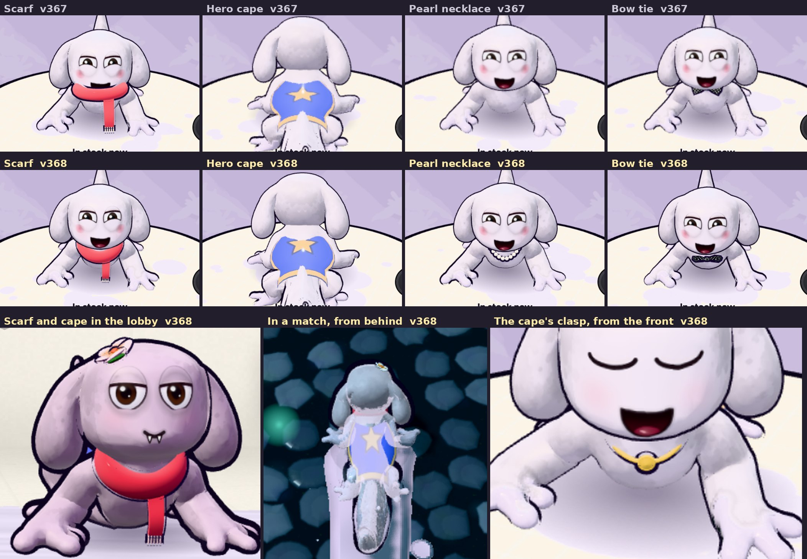

# v368: the scarf, pearl necklace, bow tie and hero cape fitted to the axolotl

## What was wrong

- **Scarf, pearl necklace and bow tie.** All three were pinned "under the chin": a point low on the front of the head, set when the
  character was a round head on a small body. On today's axolotl, with its big head and its neck tucked under the back of it, that
  point is its mouth. The scarf wrapped its snout like a muzzle with its end hanging off its lip, the pearls were drawn inside its head
  (so they never showed, in the shop or anywhere else), and the bow tie sat on its chin.
- **Hero cape.** It started at the chest joint, behind the shoulders, so it lay on the back like a saddle cloth, with bare body between
  it and the head.

## What it does now

- **Round the neck.** The three neck pieces sit on the axolotl's neck (the line from its chest joint to its head's, under the back of
  the head) and turn, tip and give with it as it moves.
  - **Scarf:** wraps the neck, chunkier than before so it reads as a knitted scarf rather than a cord. Its end hangs straight down from
    the front whichever way the neck is tipped, swinging a little. From behind it shows between the ears.
  - **Pearl necklace:** hangs across the throat and runs up the sides of the neck.
  - **Bow tie:** at the throat.
- **Hero cape:** starts at the neck, tucked under the back of the head, and runs down the back to the base of the tail as before (it still
  ripples, and streams out behind at speed). It's tied on with a gold cord round the neck and a gold button at the throat, turned to
  face forward (the clasp was a thin ring).

## Tested

- **The Paint Shop's try-on** of all four, from the front, three-quarter, both sides and behind, on a light grey look with the flower
  and fangs. The scarf sits round the neck from every side (from behind it shows between the ears), the pearls show from the front and
  three-quarter, the bow tie sits at the throat, and the cape meets the back of the head. Two other scarf fits were tried, lower and
  bigger; they read as a bib, so the snug one stayed.
- **The lobby and a match** with the scarf and the cape on: in the lobby the scarf wraps the neck with its end hanging down; in a match,
  seen from behind, the scarf shows at the back of the neck and the cape runs from under the head to the hips. No page errors.
- **The earlier tests** pass on this build: the v352 checks (25 of 25), v351's two (26 of 26, 7 of 7), v355's (27 of 27) and v354's
  (24 of 24), and the dashboard's end-to-end (38 steps) and live tests (13 steps).
