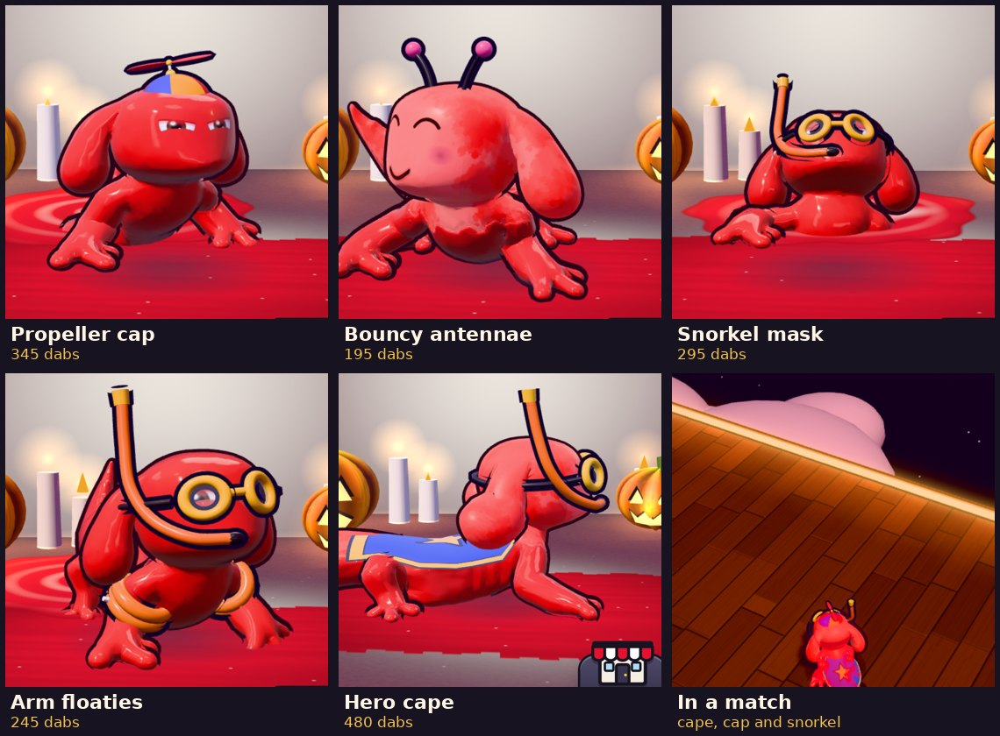

# v302: five new everyday wearables

Five fun, basic pieces, two of them worn on the body. All five are in stock from the start (bought outright, nothing to find first), like the v238 set.

| Piece | Slot | What it does |
|---|---|---|
| Hero cape | Clothing (back) | Royal blue with a gold hem and a gold star, lined in red. It runs from the shoulders to the base of the tail and follows the spine as the body bends. It ripples, and at speed its back half lifts and streams out behind you. |
| Propeller cap | Headgear | A six-panel cap in red, yellow and blue with a bill. The propeller spins all the time, faster the faster you go, and faster still in the air. |
| Snorkel mask | Facial (eyes) | Yellow goggles over both eyes, a strap along the sides of the head that tucks under the ears, and an orange snorkel from the mouth up past the head. |
| Arm floaties | Clothing (arms) | A pair of orange water wings, one on each upper arm, each with two chambers and a little white valve. They swing with the crawl. |
| Bouncy antennae | Headgear | Two springy stalks with pink pom-pom tips. They splay out, bob, and lag behind when you move, land or turn. |

## Cool versus basic

Each piece is scored 0 to 3 on five things:

- **Silhouette:** how much it changes your outline.
- **Motion:** whether it moves on its own (speed, jumps, turns).
- **Seen in play:** how much of it the match camera shows. The camera sits behind and above you, so the back and the top of the head are what rivals see.
- **Theme:** how well it suits an axolotl in a paint game.
- **Craft:** how much is in it.

| Rank | Piece | Silhouette | Motion | Seen in play | Theme | Craft | Total (of 15) |
|---|---|---|---|---|---|---|---|
| 1 | Hero cape | 3 | 3 | 3 | 2 | 3 | **14** |
| 2 | Propeller cap | 2 | 3 | 3 | 2 | 3 | **13** |
| 3 | Snorkel mask | 2 | 0 | 2 | 3 | 3 | **10** |
| 4 | Arm floaties | 1 | 1 | 1 | 3 | 2 | **8** |
| 5 | Bouncy antennae | 1 | 2 | 2 | 1 | 1 | **7** |

- **Hero cape (coolest):** it covers the whole back, which is the part of you rivals see most. It is the only piece that reacts to how fast you go across its full length, and it reads as a hero at a glance. The blue and gold shows on every paint colour; a red cape vanished on red paint, which is why it isn't red.
- **Propeller cap:** almost as strong. It sits on top of the head where the camera always sees it, and the spinning propeller is a live speed gauge. It loses a point on silhouette to the cape.
- **Snorkel mask:** the best theme fit, since an axolotl is a water animal. From behind you see the tube standing up past the head; the goggles show in the locker, the results and the knockout cam. It doesn't move on its own.
- **Arm floaties:** funny and on theme, but they sit low on the arms, so from above you mostly see them at the sides.
- **Bouncy antennae (most basic):** the simplest build, two stalks and two pom-poms. The bob gives them life, but they are thin on screen and don't say much about the character.

## Prices

The shop's existing bands:

- Everyday pieces: 145 to 290 dabs (flower 145, scarf 180, bow tie 185, mustache 195, beanie 205, party hat 240, glasses 270, monocle 290).
- Mid tier: 330 to 475 dabs (eye patch 330, fangs 400, tiara 475).
- Premium finds: 545 and up.

Each new piece is priced against its closest existing equivalent, then placed in rank order.

| Piece | Price | Compared with | About this many matches |
|---|---|---|---|
| Bouncy antennae | 195 | Mustache 195, beanie 205: same size of build, one stalk pair | 4 wins, or 8 to 10 losses |
| Arm floaties | 245 | Party hat 240: two pieces instead of one, on the body | 5 wins |
| Snorkel mask | 295 | Glasses 270, monocle 290: a fuller eye piece (lenses, strap, tube) | 6 wins |
| Propeller cap | 345 | Just above the eye patch (330): an animated hat that's still everyday, well under the found hats (580 and up) | 7 wins |
| Hero cape | 480 | Top of the mid tier, beside the tiara (475), under the premium finds | 9 to 10 wins |

The first four step up by about 50 each. The cape jumps a bit more because it stands out more.

The match estimates use the current payout: 8 dabs, plus a third of your coverage, plus 30 for a win, so about 50 for a typical win and 20 for a loss. Commissions add 20 each. All five together cost 1,560 dabs.

## How they're fitted

The face and body pieces are placed on the axolotl's real shape, measured by raycasting the model in the game:

- **Face:** 0.44 out at the middle and 0.40 at the eyes, measured from the head's centre.
- **Back:** 0.21 to 0.26 above the spine. **Sides:** 0.53 to 0.59 out.
- **Upper arm:** about 0.18 thick.

Measuring them this way keeps the pieces sitting on the body rather than floating off it or sinking in.

- **Snorkel lenses:** each one turns outward with the curve of the face.
- **Cape:** each row is an arc a little bigger than the body's cross-section. It is narrower over the hips, where the knees come up, and draped over the tail.
- **Floaties:** they ride the upper-arm bones, with the valve facing out.

A swim ring was the first idea for a body piece. It was dropped because the axolotl crawls with its belly on the floor, so anything round its waist sinks into the ground. The arm floaties keep the swimming idea without that problem.

Only your everyday axolotl wears the face and body pieces; the other forms hide them, as they do with the existing face pieces. The cape and the floaties are both clothing, so like the scarf, bow tie and pearls you wear one clothing piece at a time.

## Also fixed

When the axolotl loads, it moves anything on the body it doesn't recognise into the hidden old-blob group. Each new piece now has to be added to that list (`attachSlime`), or it never shows; all five are on it.
