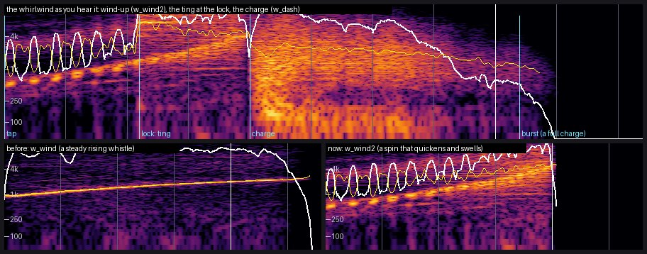

# v390: the Whirlwind's new sounds

The user asked for a better whirlwind sound, made with Ludo. The Whirlwind now has two sounds of its own, both made from Ludo.ai
sound-effect takes, and `tools/v390_whirl_sfx.py` plays them.

*Spectrograms (50 Hz to 16 kHz, log scale). The white line is the level and the yellow line is the spectral centroid. Grid lines are
every 0.25 s, with a brighter one each second. Top: the wind-up, the ting at the lock and the charge, mixed as the game plays them (the
burst at the end of a full charge is the game's own synth and isn't drawn). Bottom: the old wind-up and the new one, on the same scale.*

| Sound | File | When | What you hear |
| --- | --- | --- | --- |
| Wind-up | `game/sfx/w_wind2.mp3` (1.02 s, 12.9 KB) | as the Whirlwind is used (`startWhirl`) | Air is sucked in and starts to spin. A whirring flutter quickens (about 10 to 20 beats a second) and climbs in pitch (0.5 to 2.4 kHz). It swells by 14 dB and is loudest at 0.95 s, just as the charge goes. Airy wind rushing in builds under it over the last half. The glint's ting still sounds at the lock (0.55 s). |
| Charge | `game/sfx/w_dash.mp3` (1.32 s, 16.3 KB) | when the charge starts (wind-up over) | A tornado roar that is at full from its first moment, with a splashy whump of paint on top. It holds for about half a second and dies away by the end of the 1.1 s charge, getting less bright as it goes. If the charge stops short (a wall, a drop, or stopped dead), it fades out in 0.15 s as the burst goes off. |

- A rival's whirlwind plays the same sounds within earshot (14 units), quieter further off: from full when close down to 0.45 at the
  edge, as `at()` sets the game's other sounds. Before, a rival's wind-up played at the same level wherever the rival was.
- Until a file has arrived, the old sounds play: the synth rise for the wind-up, and the boost, the dash and a swish every 0.26 s for
  the charge. The files are fetched with the ting when a match starts (`placePowers`). The old `w_wind.mp3` is no longer played.
- To fade a sound, `xplay` now returns a handle, `{ stop(seconds) }`, instead of `true`. The handle is truthy, so callers that only
  check whether a sound played still work. Each whirlwind keeps its handle, so the wind-up fades (40 ms) as the charge starts. If the
  whirlwind ends early (the match ends, or it is reset), whatever it is playing fades too.
- The swishes only play with the synth charge. Under the roar they were about 20 dB down and couldn't be heard.
- No knock-out swish was added. A knock-out in the charge already has its own sounds (a flattened splat, and your cry if it's you),
  and the burst ends the charge. A fourth whirlwind sound wouldn't clearly help.

## The takes

All came from Ludo's sound-effect endpoint. Every prompt ended with ", cartoon mobile game sound effect, no music, no voice", and each
was made twice. Request ids were `rm390-whirl-<name>`.

| Takes | Asked for (s) | Prompt |
| --- | --- | --- |
| wind_a1, a2 | 1.2 | a cartoon whirlwind spinning up: air being sucked inward and swirling faster and faster, a rising whooshing spin that builds to a peak and releases |
| wind_b1, b2 | 1.2 | a small tornado charging up, a swirling wind vortex accelerating with rising pitch, a whoosh building in intensity to a sudden peak, bright and playful |
| wind_c1, c2 | 1.2 | a reverse whoosh: wind rushing in and spinning up faster and faster around a spot, rising tension that swells to a peak, light and airy |
| wind_d1, d2 | 1.1 | a whirlwind winding up: starts as a soft breath of air being sucked in, then spins faster and faster and grows louder, rising in pitch to its loudest at the very end |
| wind_e1, e2 | 1.1 | a swirling whoosh that starts quiet and swells louder and higher, wind whirring round faster and faster like a spinning top, a crescendo that stops at its peak |
| wind_f1, f2 | 1.1 | a cartoon tornado spin-up crescendo: whirring, swirling air accelerating, rising pitch and rising volume, building suspense right up to a release |
| dash_a1, a2 | 1.4 | a cartoon tornado dashing past: a punchy burst into a big roaring whoosh of spinning wind that rushes by and fades away |
| dash_b1, b2 | 1.4 | a spinning tornado shooting forward, a powerful sudden blast of swirling wind with a fast whirling flutter, a rushing roar that dies away |
| dash_c1, c2 | 1.4 | a fast whirlwind charge: a sharp punchy whoosh straight into a rushing, spinning wind roar that passes by and trails off, bright and fun |
| dash_d1, d2 | 1.4 | a whirling tornado of wet paint zooming past, a strong whooshing wind roar with a splashy spray, punchy start, fading out |

The wind_d to wind_f prompts were a second round. Only one of the first six wind-up takes got louder toward its end.

## How they were picked

No one listened to these sounds. They were picked by measurement and by looking at spectrograms. Each take was measured for:

- its length, onset and the time of its loudest moment;
- its level in thirds;
- the movement of its spectral centroid;
- clipping, and how much level it loses when mixed down to mono (the game plays mono);
- silences of 60 ms or more inside it;
- the share of its energy above 250 Hz (what a phone speaker can play);
- a pitch-strength measure that flags a voice, an instrument or a steady whistle;
- how strong and how fast its flutter is.

None of the takes clipped. None had a voice or music: there were no harmonic stacks, and no steady tones except a whistle in a few
takes, which counted against them.

**Wind-up: wind_b1 sped up, over wind_c1.**

- wind_c1 is the only take of the twelve that keeps getting louder. It gains 26 dB from its first fifth to its last and is loudest at
  0.93 s, right where the release comes. Its centroid climbs from 4.2 to 6.5 kHz, and it is plain air, with no pitch.
  - Alone, though, it is a bright hiss (72% of it is over 4 kHz) and almost silent for its first 0.2 s, so the tap would have nothing
    to answer it. It plays under the spin as the air rushing in, with 5 dB taken off above 6 kHz.
- wind_b1 has a quick, even flutter (about 13 beats a second, a little quicker at its end) on a band that already climbs from 0.6 to
  1.6 kHz. Only a quarter of it is pitched, it has no gaps, it holds in mono, and it is the longest of the fluttering takes (1.18 s),
  long enough to be sped up (that needs 1.08 s):
  - its playback rate glides from 0.75 to 1.5 times over the second, so the flutter quickens and the pitch rises an octave: a spin-up;
  - its own slow rises and falls are evened out, then it is swelled from 14 dB down to full at 0.95 s.
- The finished sound is loudest at 0.98 s, with thirds at -18, -12 and -4 dB. Its centroid rises from 2.4 to 4.3 kHz, and 34% of it is
  over 4 kHz, against 72% for wind_c1 alone.
- Why the others lost:
  - wind_a1 has a climbing band, but it is loudest at 0.37 s and more than half of it is a whistle, much like the old `w_wind`, which
    is one pure rising tone.
  - wind_a2 rises and falls.
  - wind_b2, c2, d1 and f1 die away.
  - wind_d2, e1, e2 and f2 pulse at one level and never swell. They are also too short to speed up (e1), lose 1 to 1.5 dB in mono
    (e1, e2) or are mostly pitched (d2 41%, f2 71%).

**Charge: dash_b2, with the start of dash_d2 on top.**

- dash_b2 is at full within 15 ms and holds for about half a second, then dies away smoothly (thirds -2, -7 and -26 dB) over 1.36 s,
  about the charge's 1.1 s plus a fade.
  - Its centroid falls from 2.4 to 1.2 kHz, like something rushing past and away.
  - It is noise with no pitch, and 93% of it is over 250 Hz, so a phone plays it.
  - It only loses 1 dB in mono and has no gaps.
- Its start had no accent: the first 150 ms are only 0.9 dB over the body. So the first 0.3 s of dash_d2 is laid on top. That part is
  a splashy whump of wet paint, 13 dB over its own body. Below 150 Hz is cut, and its loudest 30 ms sit 4 dB over the roar's. That
  makes the opening hit 5.4 dB over the body.
  - The start of dash_c1 was tried too. It is a sharper hit, but its peaks are so high that it only made 2.6 to 4.8 dB of punch, for
    1.9 to 4.8 dB of limiting.
- Why the others lost:
  - dash_a1 is a steady whistle at 1.3 kHz with a swell at 0.83 s, not a punch.
  - dash_a2's two channels are out of phase: it loses 4.9 dB in mono.
  - dash_b1 is shorter (1.02 s) and duller (41% under 250 Hz).
  - dash_c1 has a 0.33 s hole and is 70% pitched.
  - dash_c2 is a low tone (72% under 250 Hz).
  - dash_d1 is short, with a 0.15 s hole.

## How they were finished

They were finished with the code in `tools/boss_sfx_build.py`. Each take was mixed to mono, and the rumble under 35 Hz was cut (zero
phase). The charge was trimmed from 3 ms before its onset to 40 ms after it last passes -48 dB, faded in over 2 ms and faded out over
0.12 s. The wind-up was cut at 1.02 s with a 50 ms fade.

Each file carries its own mix (the loudest 400 ms, K-weighted), and the whirler hears it at full level:

- wind-up: -13 LUFS, which is its last moments;
- charge: -12 LUFS.

Peaks were held under -1.5 dBFS. The limiter took nothing off the wind-up and 1.9 dB off the charge's hit. After encoding, the peaks
are at -1.2 and -1.1 dBFS.

That puts them between the game's ground pound (about -7 to -11 LUFS as played) and its boost, burst and knock-out sounds (-20 to -24).
The old `w_wind` played at -6.6 LUFS for its whole 1.3 s.

Like the rest of `game/sfx`, both are mp3 files at 44.1 kHz, mono, 96 kb/s. The same takes give the same files, byte for byte.
