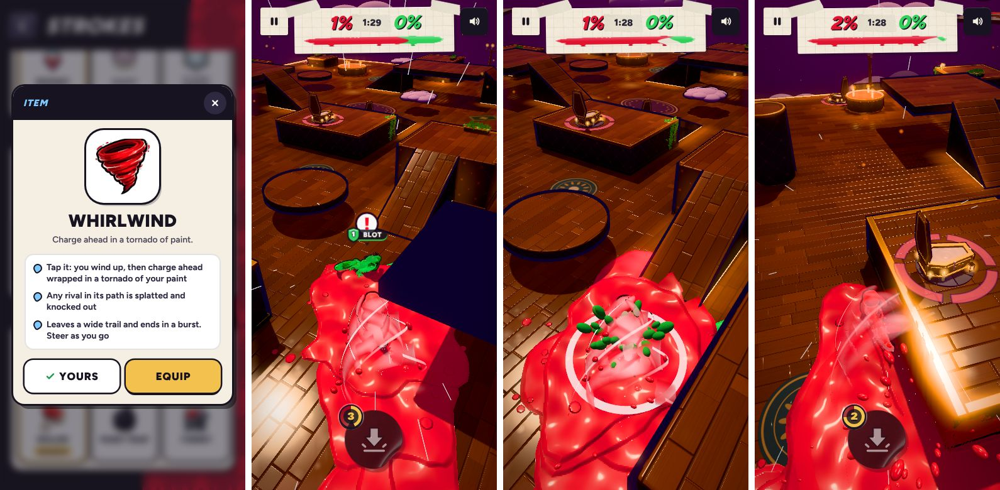

# v271 Whirlwind

A new item, after the user's clip of a charge that wraps the character in a sideways tornado of paint (`tools/v271_whirl.py`).

## How it plays

| Phase | Time | What happens |
|---|---|---|
| wind-up | 0.3 s | You stop, and the tornado spins up round you with sparks drawn in |
| dash | up to 1.1 s | You charge at 2.5x your pace (about 14 m/s, about 15 m). Steering is half strength, and the dash leans up to 1.6 rad/s toward a rival within 9 m and inside a 0.55 rad cone ahead. It paints a 1.9 m splat every 0.7 m. Any rival within 1.75 m is knocked out (`'crush'`, credited to you) |
| burst | 0.4 s | A 2.75 m splat, a shockwave, and any rival within 2.4 m knocked out. The tornado is thrown wide and fades |

- You're untouchable from the wind-up to the end (`safe()`). You can't jump, roll, pound, use another item or drop into a basin until it's over (`canAct`, `useHeld`, the basin check).
- The dash ends early, with the burst, if the ground 0.9 m ahead drops away or you run into a wall, so it never carries you off an edge.
- If you're knocked out, put out, or the match ends while it's going, it stops at once (a guard at the top of `stepBlob`, and in `resetRun`).

## Where you get it

- **On the canvas:** it's in the item spawn mix outside the lessons (weights roller 0.42, turret 0.3, trap 0.28, whirlwind 0.3).
- **As your starting item:** it's a fourth choice in the Abilities item row, with an icon painted by Ludo.ai (`tools/assets/item_whirl_256.webp`) and a tornado icon on the in-match button.
- **CPUs:** they start with it about 22% of the time. A CPU uses it when you're 2 to 10 m away and within 0.7 rad of straight ahead, or after holding it 8 s. It squares up to the nearest rival first.

## The look

- **The tornado:** three wide bands of your paint spiral round the forward axis, from 0.32 m wide at the nose to 1.05 m behind. Two narrower inner bands spin the other way, and four thin white streaks spin with them. All of it spins at about 22 rad/s through the dash.
- **The shader:** a glossy paint shader with a lighter band down each ribbon and darker edges, so the spiral reads over paint of the same colour. The streaks are additive.
- **Extras:** droplets of your paint are flung off it as it goes.
- **Warm-up:** one copy is kept hidden in the scene so the loading warm-up builds its shaders.
- **The pick-up:** a small tornado standing in the bubble.

Sounds: the wind-up uses `AU.rise`, the launch `AU.boost` and `AU.dash`, the dash plays `AU.swish` every 0.26 s, and the burst uses `AU.burst` and `AU.splat`.
